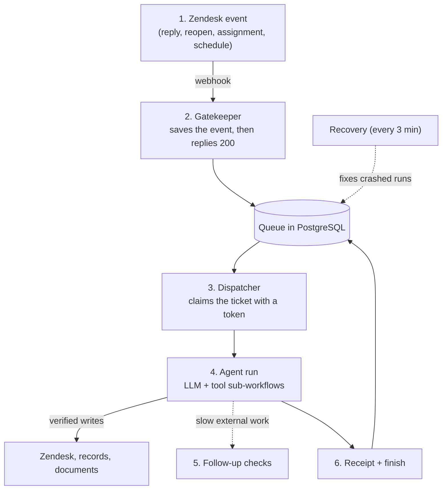

# AI support agents in production

## The problem

A support team handled a high volume of Zendesk tickets that followed the same long
process: check the customer's records against business rules, ask for anything missing,
prepare documents, deliver, follow up and close. I built AI agents that work these
tickets end to end, unattended. Building the agent was the easy part; making it safe to
run on live customers was the real work.

This repository is a **rebuilt, runnable version of the core mechanisms on invented
data**. The production system is private.

## What I built



1. Zendesk triggers and automations decide when the agent should act and send a webhook
   with the reason. [Zendesk events](docs/zendesk-events.md)
2. The gatekeeper stores the event before acknowledging it. [Queue](docs/queue.md)
3. The dispatcher gives each ticket to exactly one run. [Queue](docs/queue.md)
4. The agent follows a stage-based procedure and acts only through tools. [Agents](docs/agents.md)
5. Slow work, like documents made by an outside service, is checked on a schedule.
   [Follow-up checks](docs/follow-up-checks.md)
6. The run records that it finished; recovery repairs anything that crashed. [Queue](docs/queue.md)

I also built an **orchestrator** version where a small routing model hands each event to
one of three stage specialists. [Orchestrator](docs/orchestrator.md)

## Hard problems I solved

| Problem | What I did |
| --- | --- |
| Zendesk retried webhooks and bursts of events arrived, so one ticket was worked twice at once. | A database queue: duplicates are ignored, bursts merge into one run, and each ticket has exactly one owner, enforced by the database. |
| A run crashed after replying to the customer; retrying would message them again. | The agent writes a durable "work done" receipt. Recovery completes the run from the receipt instead of re-running the agent. |
| Failures retried forever and burned model calls. | Three attempts per event, then a visible stop that alerts a person. A genuinely new event gets a fresh budget. |
| Ticket updates by the agent itself re-triggered the agent. | "Pending" and "working" tags guard the Zendesk rules, and customer replies always get through as one follow-up run. |
| "Document requested" did not mean "document created". | A follow-up timer checks, re-requests up to three times, then escalates in steps that resume safely after a crash. |
| One huge prompt with every tool on every run was slow and costly. | An orchestrator with stage specialists, each with only the instructions and tools it needs. |

## How it evolved

The first version called the agent straight from Zendesk and re-ran the model when its
output was invalid. That broke under real traffic, so I moved to a durable queue,
removed the automatic re-run loop, made every side effect verified, and then split the
single agent into specialists. Prompt changes were tested on a chat copy of each agent
before release.

## Stack

n8n (self-hosted, queue mode) · OpenAI models · PostgreSQL · Redis · Railway · Zendesk
triggers, automations and API · Slack

## Run it

```bash
npm install
npm test       # 22 tests
npm run demo   # a scripted story: webhooks, a crash, recovery, routing
```

The tests prove the logic behind the guarantees above against real SQL (an in-memory
PostgreSQL): duplicates, merging, one owner per ticket, retry limits, stale workers,
recovery, follow-up timing and routing. Code: [db/queue.sql](db/queue.sql),
[src/followup-check.js](src/followup-check.js), [src/orchestrator.js](src/orchestrator.js).

**Deep dives:** [Zendesk events](docs/zendesk-events.md) · [Queue and recovery](docs/queue.md) ·
[Agents](docs/agents.md) · [Follow-up checks](docs/follow-up-checks.md) ·
[Orchestrator](docs/orchestrator.md)
