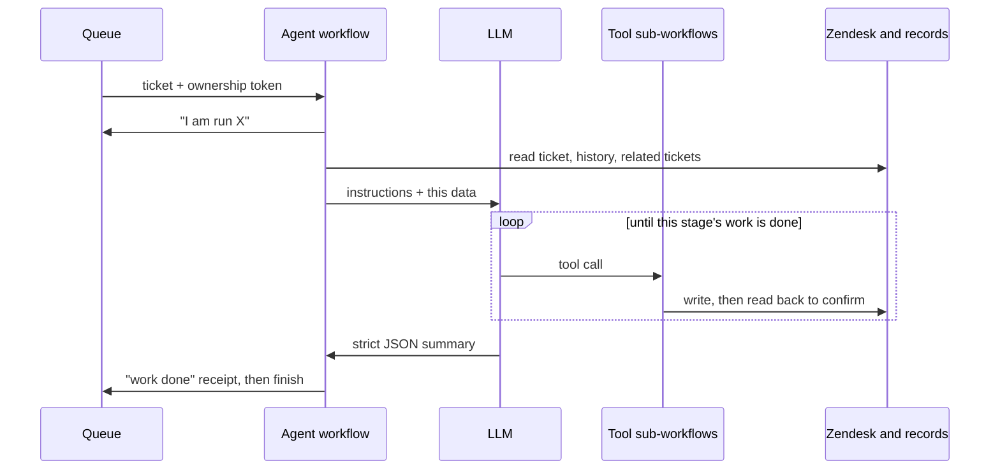

[Back to overview](../README.md)

# The agents

Two production agents, one per service line, each on its own n8n instance with its own
database and credentials, so a problem in one could never affect the other.

## How a run works

1. **Context first.** Before the model starts, the workflow collects the ticket, why it was
   woken up, and the customer's related sales and support tickets.
2. **A stage-based procedure** in the prompt: take ownership, check the customer's records
   against the rules for their service, ask for anything missing in one message, prepare
   and deliver the output, follow it through fulfilment, and close the ticket.
3. **Tools are sub-workflows**, each doing one thing safely: read and update records,
   generate and fetch documents, extract data from images, read ticket history, check an
   external status, reply publicly, add an internal note, escalate, deliver files, message
   a partner on Slack, merge duplicate tickets. Some call small services I built and
   hosted separately, such as a file conversion API.
4. **A strict JSON summary** at the end, which the workflow parses before finishing.

## Rules that mattered more than the model

- Re-check the evidence on every run; never trust what a previous run concluded.
- Ask the customer for everything missing in **one** message.
- Save new customer information to the records as soon as it arrives.
- Never show internal automation wording to customers.
- Write a final internal note after other changes, then **verify the ticket's resulting
  status** instead of assuming the update worked.
- Clear escalation routes for billing, out-of-scope work and contradictory evidence.

## Testing changes safely

Each agent had a chat copy with the same prompt and tools. I used it to ask "what would
the agent do on this ticket?" and to try prompt changes on real cases before releasing
them. Every failed execution posted one alert with a link to the exact run.
