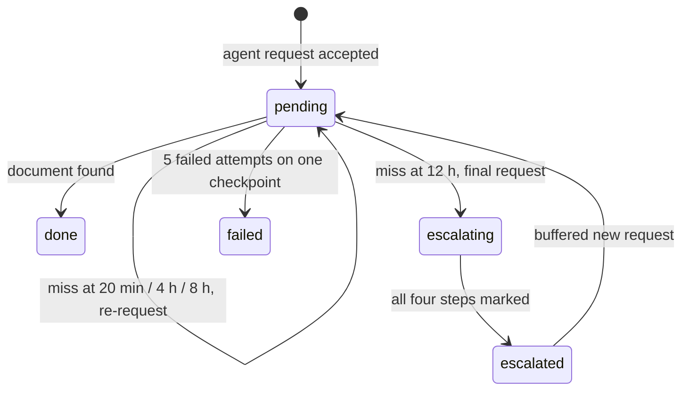

[Back to overview](../README.md)

# Follow-up checks for slow external work

Some tools only *request* work from an external service. "Request accepted" did not mean
"document created". Instead of making the agent wait, the request registers a check, and
a scheduler runs it. [src/followup-check.js](../src/followup-check.js)

- Checkpoints about 20 minutes, 4, 8 and 12 hours after the first accepted request,
  anchored to that time so a backlog doesn't shift the schedule.
- Each of the first three misses sends one automatic re-request; only accepted ones count.
- A lookup error is **not** evidence the document is missing.
- At the final miss: one last request, then escalation in four separately marked steps
  (mark the record, notify the production partner on Slack, update the Zendesk ticket and
  tags, alert the owner). A crashed run resumes from the first unfinished step.
- Five attempts per checkpoint, counted at claim time so crashes count too, then the
  check is marked failed for a human instead of looping.
- A new agent request during a cycle refreshes the timer without spending a retry; during
  escalation it is buffered and starts a fresh cycle afterwards.
