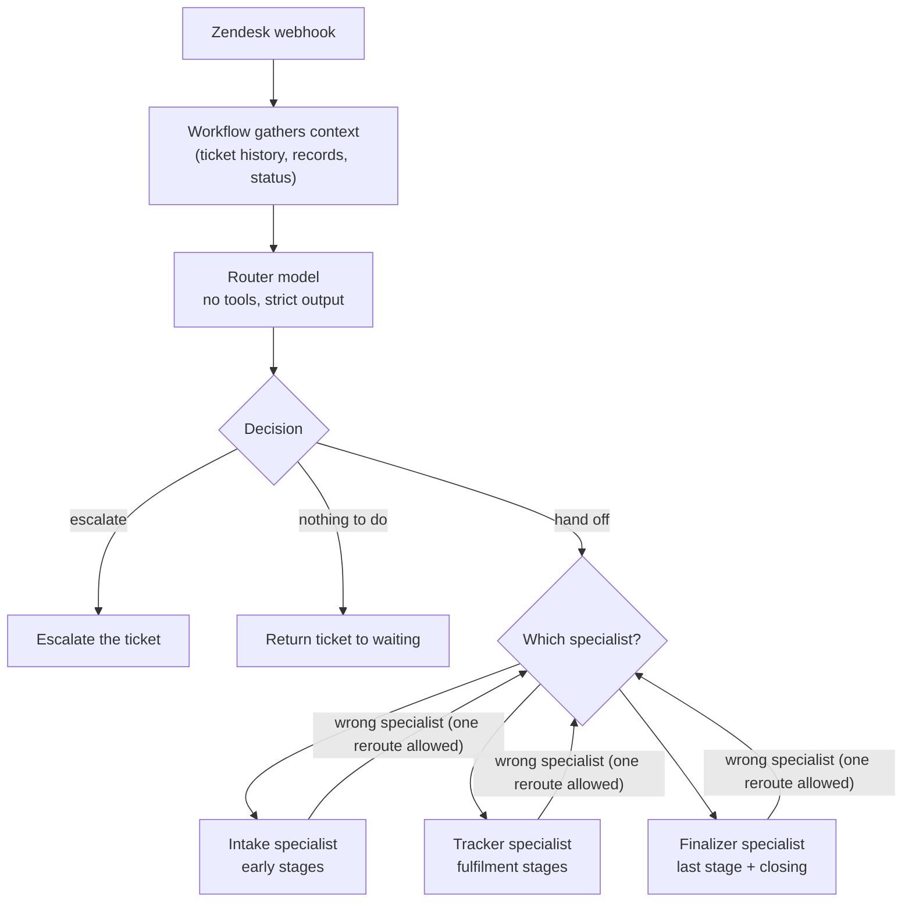

[Back to overview](../README.md)

# Orchestrator and specialist sub-agents

**Problem:** the single agent carried one very large prompt and every tool on every run,
even when an event only needed a quick status check. That cost input tokens, slowed runs
and diluted the model's focus.

**Solution:** split deciding from doing. [src/orchestrator.js](../src/orchestrator.js)

- **Context gathering moved out of the model.** Plain workflow steps fetch the ticket,
  records and status; no tool calls are spent on that.
- **The router has no tools.** It must return a strict decision: escalate, nothing to do, or
  hand off to one named specialist with a short instruction. Anything else escalates.
- **Each specialist** gets the same small input, a prompt for its stages only, and only the
  tools those stages need.
- **No loops.** A specialist can say "wrong specialist" once; a second handoff escalates.

**Result:** it ran in production on live tickets with results comparable to the single
agent. The design estimate was roughly 30 to 40% less input context per run, and much
less for routine events.
