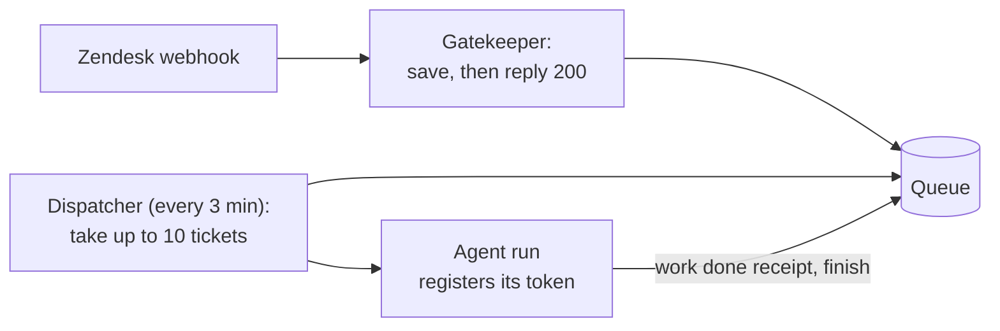
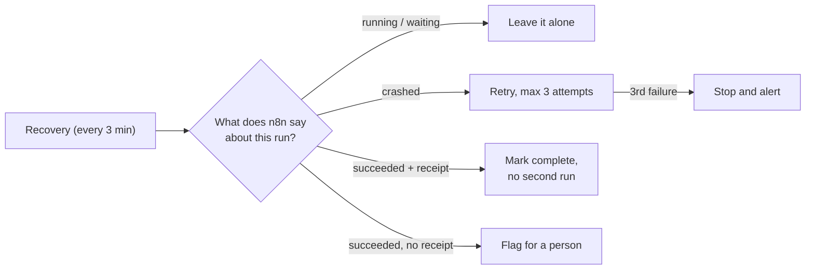

[Back to overview](../README.md)

# Queue and recovery

The first version started the agent straight from the Zendesk webhook. Real traffic broke
it: bursts of events for one ticket, Zendesk retrying deliveries, customers replying
mid-run, and runs that crashed or timed out. I replaced it with a queue owned by the
database. The SQL is in [db/queue.sql](../db/queue.sql) and tested in
[test/queue.test.js](../test/queue.test.js).

## The normal path

- **Save before acknowledging.** Zendesk gets 200 only after the event is stored.
- **Duplicates are free.** A repeated delivery ID creates no new work.
- **Bursts merge.** Waiting events for one ticket become one run with the latest data.
- **One owner per ticket**, enforced by the database, not by timing or tags.
- **Manual runs first**, then oldest. Several dispatchers can run without clashing.
- **Ownership tokens.** Each claim gets a random token; only the run holding it can finish,
  and a run whose token was taken back stops before touching the ticket.
- A customer reply on an idle ticket starts immediately instead of waiting for the batch.

## When something fails

- A run that never started within 20 minutes loses its token and goes back to the queue.
- A crash is retried with a pause, three attempts in total, then stops visibly.
- **The receipt matters**: a run that finished its work but crashed during bookkeeping is
  completed from the receipt, so the customer is never messaged twice.
- If n8n's API is down, nothing is assumed; a missing run is trusted only after an hour.
- **Reconciliation** re-reads Zendesk's log of failed webhook deliveries, so events lost
  during an outage are recovered without overwriting newer ones.
- **Tag sync** keeps the ticket's "pending" and "working" tags in line with the queue and
  reads them back before the agent starts.
- A read-only status report shows counts per state and any ticket's full history.
