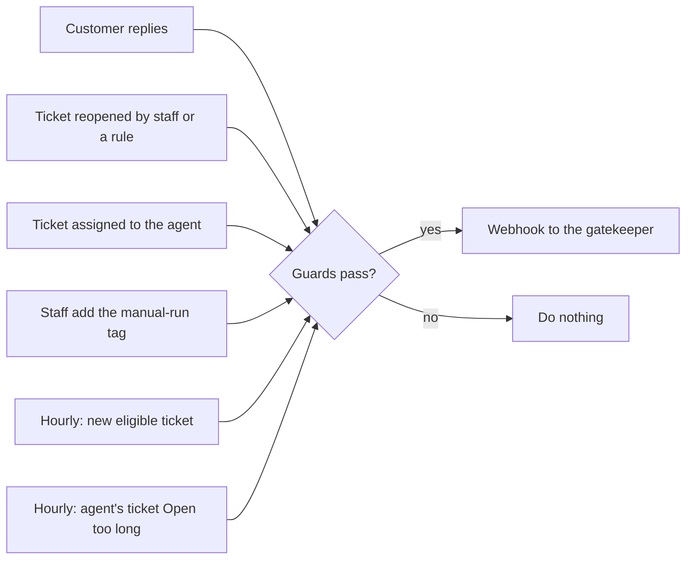

[Back to overview](../README.md)

# Zendesk events: triggers, automations and webhooks

Nobody pressed "run" on the agents. Zendesk started them, through triggers (react to a
ticket update) and automations (hourly scans) that I designed. Each rule sends the
agent's webhook the ticket ID, a run counter and a short **context** telling the agent
why it was woken up, for example "the customer responded" or "this ticket has been Open
for hours".

## What starts a run

| Rule | Type | Fires when |
| --- | --- | --- |
| Customer responded | Trigger | The customer adds a comment to the agent's ticket. Email replies that arrive as private notes count too; staff notes do not. |
| Reopened | Trigger | Anyone other than the customer moves the ticket back to Open. |
| Assignment | Trigger | A person assigns the ticket to the agent, including handing it back after an escalation. |
| Manual run | Trigger | Staff add a tag; the rule removes it and calls the agent. |
| Initial run | Automation | A new eligible ticket has waited about an hour unassigned, so staff can take it first. |
| Stale open | Automation | One of the agent's tickets has been Open longer than a set number of hours. |

## What stops a run

- **Lifecycle tags.** "Pending" means work is queued, "working" means a run is in progress.
  While either is present, the automations, assignment and reopen rules stay quiet, so the
  agent's own updates don't wake it again.
- **Customer replies always get through**; the queue turns them into one follow-up run.
- **A passive-reopen filter runs first.** Internal comments from other automations can
  reopen a ticket with nothing new for the agent; this rule puts it back to waiting.
- **Eligibility**: the right product, no rushed service levels handled by people, no merged
  tickets.
- **Rule order** is fixed, so one update can't fire two rules.
- **A failsafe** clears a "pending" tag left on a ticket with no activity for many hours, so
  a lost event can never block a ticket forever.

Changes were made by creating replacement rules and switching the old ones off, so any
change could be undone instantly. The tags only guard Zendesk; the database queue decides
who actually owns a ticket.
